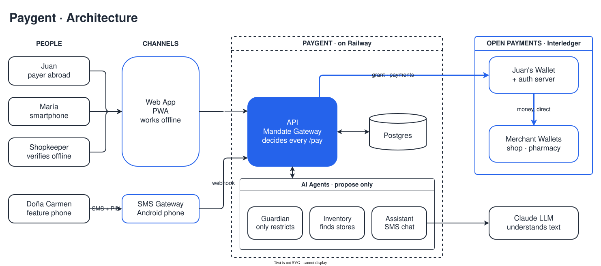

<!-- markdownlint-disable MD001 MD033 MD041 -->
<p align="center">
  
</p>

<h3 align="center">
Delegable payment power for people and their AI agents, even without internet or a smartphone.
Built on Open Payments for the Interledger hackathon.
</h3>

<p align="center">
  <a href="https://luisseoanes.github.io/paygent/"><b>Docs</b></a> ·
  <a href="https://luisseoanes.github.io/paygent/quickstart/"><b>Quickstart</b></a> ·
  <a href="https://luisseoanes.github.io/paygent/architecture/"><b>Architecture</b></a> ·
  <a href="https://luisseoanes.github.io/paygent/api-reference/"><b>API</b></a> ·
  <a href="https://luisseoanes.github.io/paygent/security/"><b>Security</b></a> ·
  <a href="https://paygent.up.railway.app"><b>Live demo</b></a> ·
  <a href="https://openpayments.dev"><b>Open Payments</b></a>
</p>

## Paygent

Open Payments assumes the payer has internet, a smartphone and their own wallet. Paygent removes all
three with one primitive: the **delegable mandate**. Juan, abroad, approves **one** grant in his
wallet. His family, their phones and AI agents spend inside signed sub-mandates carved from it:
online by QR, with no signal through signed offline vouchers, or from a feature phone by texting an
AI Assistant and confirming with a PIN. **The gateway decides every spend, never the model**, and
each payment goes straight from Juan's wallet to the merchant: nobody in the middle holds money.

---

## Architecture

<p align="center">
  
</p>

A Fastify api holds the **Mandate Gateway**: every spend — person, device or agent — goes through
`/pay` (or voucher settlement), which walks the mandate chain leaf to root and only then creates an
Incoming Payment, a Quote and an Outgoing Payment on Open Payments. Permissions only narrow down the
tree. The Python agents (Assistant, Inventory, Guardian) **propose**; they hold no keys and no
funds. The PIN never reaches the LLM, the Guardian can only restrict, and every LLM path has a
deterministic fallback.

| Path | Stack | What it is |
| ---- | ----- | ---------- |
| [`src/api/`](src/api/) | TypeScript · Fastify | Open Payments client, Mandate Gateway, vouchers, SMS, SSE feed |
| [`src/web/`](src/web/) | React 19 · Vite PWA | `/cuenta` `/billetera` `/enlazar` `/tendero` `/celular` |
| [`src/shared/`](src/shared/) | TypeScript | Contract types, amounts, ed25519 voucher signing |
| [`src/agents/`](src/agents/) | Python · FastAPI · Claude | Assistant, Inventory, Intent compiler, Guardian |

→ **[Architecture](https://luisseoanes.github.io/paygent/architecture/)** and
**[Payment flow](https://luisseoanes.github.io/paygent/payment-flow/)** for the full picture.

---

## Getting started

### The application

Requires Node 22 (`.node-version`), pnpm 11 and [uv](https://docs.astral.sh/uv/) (Python ≥ 3.11).

```bash
cp .env.example .env     # defaults run everything in mock mode, no keys needed
pnpm setup               # pnpm install + uv sync in src/agents
pnpm dev                 # api :3001 · web :5173 · agents :8000
pnpm test                # vitest + pytest
```

Open <http://localhost:5173> and log in as `juan@paygent.dev` / `paygent123` (demo PIN `1234`).

| Flag | Default | In the demo |
| ---- | ------- | ----------- |
| `MOCK_OP` | `1` (Open Payments simulated) | **Always `0`: money is real** |
| `MOCK_LLM` | `1` (deterministic rules) | `0` with `ANTHROPIC_API_KEY`; falls back to rules on error |
| `MOCK_SMS` | `1` (`/celular` simulated phone) | `0` with SMS Gateway for Android or Telnyx |

→ [Quickstart](https://luisseoanes.github.io/paygent/quickstart/) for real Open Payments keys
(`pnpm op:smoke`), tunnels and demo data.
→ [Configuration](https://luisseoanes.github.io/paygent/configuration/) for every env var.
→ [SMS & AI Assistant](https://luisseoanes.github.io/paygent/sms-assistant/) to plug in a real phone.
→ [Deployment](https://luisseoanes.github.io/paygent/deployment/) for Railway (production:
<https://paygent.up.railway.app>).

The docs site is built with [Zensical](https://zensical.org) from [`site-docs/`](site-docs/):

```bash
pnpm docs:dev            # http://localhost:8001
pnpm docs:build          # ./site
```

### Working with an agent

This repository is built with coding agents (Claude Code). Each area has a context file the agent
reads first, and `TODO <ID>` markers in the code point at backlog tasks.

| File | When it matters |
| ---- | --------------- |
| [`CLAUDE.md`](CLAUDE.md) | Every session: invariants, commands, layout |
| [`src/web/CLAUDE.md`](src/web/CLAUDE.md) | Any web change (Bulletproof React rules, [`BRAND.md`](src/web/BRAND.md)) |
| [`src/agents/README.md`](src/agents/README.md) | Assistant, Inventory, Guardian rules |
| [`docs/producto/backlog.md`](docs/producto/backlog.md) | Contracts, endpoints and task IDs |
| [`docs/producto/context.md`](docs/producto/context.md) | The idea, the demo script and judge Q&A |
| [`AI_USAGE.md`](AI_USAGE.md), [`prompts/`](prompts/) | Hackathon AI-usage declaration and prompt log |

The team docs in [`docs/`](docs/) are in Spanish; the [docs site](https://luisseoanes.github.io/paygent/)
is their English, technical counterpart. New logic ships with a test, and money only moves through
the gateway.

---
