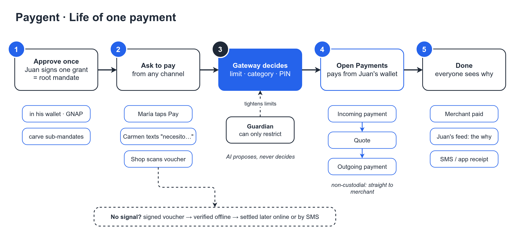
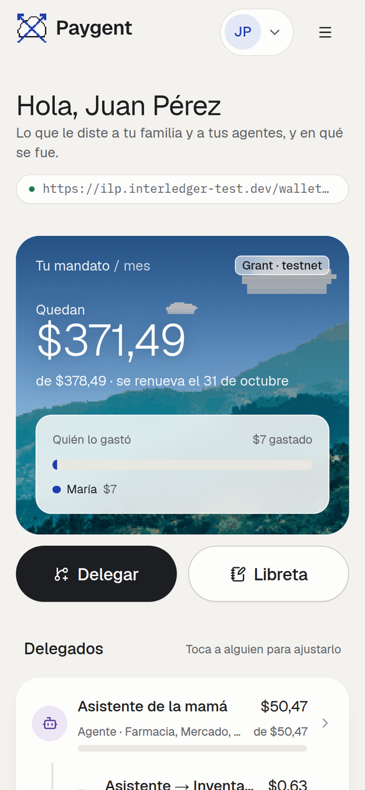
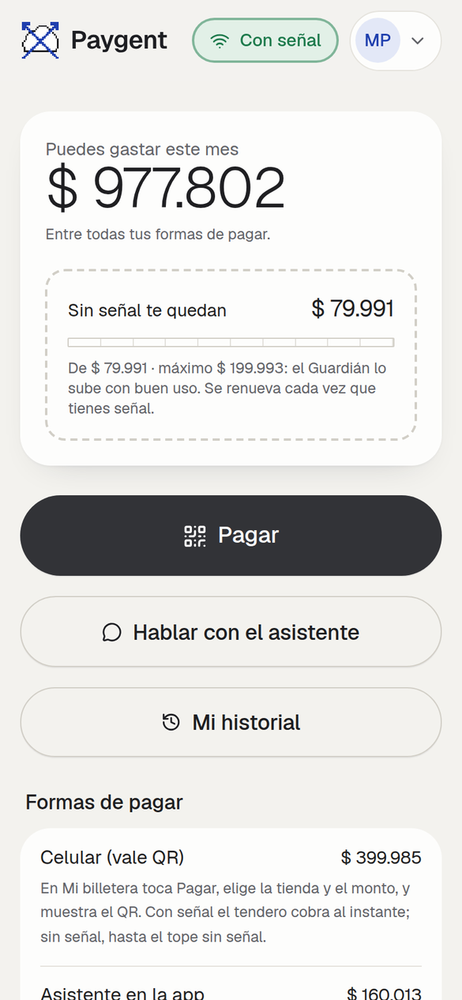
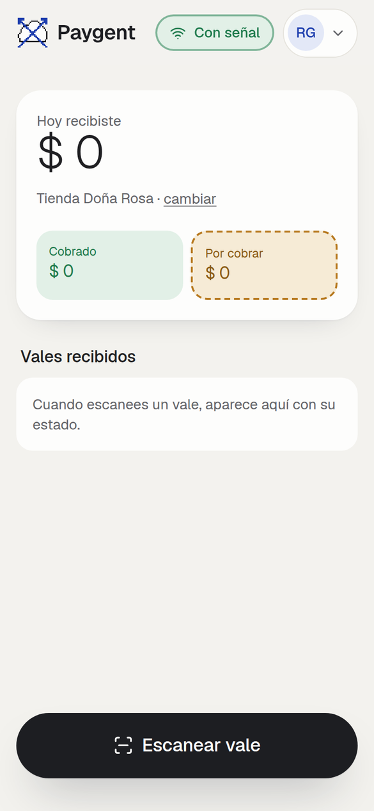
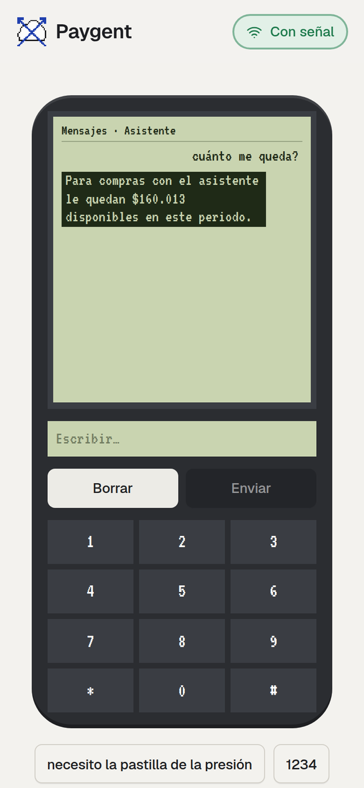
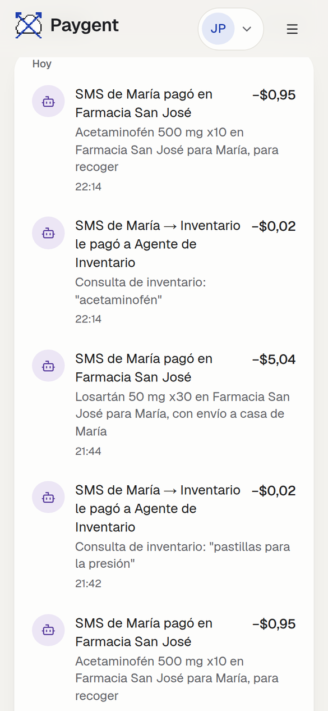
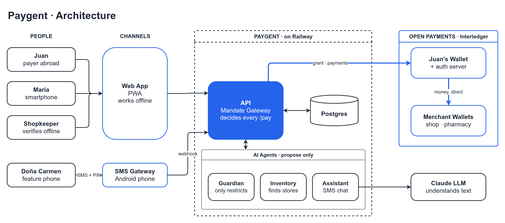

<!-- markdownlint-disable MD001 MD033 MD041 -->
<p align="center">
  
</p>

<h3 align="center">
Pay(A)gents
</h3>

<p align="center">
  <a href="https://luisseoanes.github.io/paygent/"><b>Docs</b></a> ·
  <a href="https://luisseoanes.github.io/paygent/quickstart/"><b>Quickstart</b></a> ·
  <a href="https://luisseoanes.github.io/paygent/architecture/"><b>Architecture</b></a> ·
  <a href="https://luisseoanes.github.io/paygent/api-reference/"><b>API</b></a> ·
  <a href="https://luisseoanes.github.io/paygent/security/"><b>Security</b></a> ·
  <a href="https://paygent.up.railway.app"><b>Live demo</b></a> ·
  <a href="https://openpayments.dev"><b>Open Payments</b></a>
</p>

## Overview

Pay(A)gents is a delegable payment power for people and their AI agents, even without internet or a smartphone.
Built on Open Payments for the Interledger hackathon.

Open Payments assumes the payer has internet, a smartphone and their own wallet. Paygent removes all
three with one primitive: the **delegable mandate**. Juan, abroad, approves **one** grant in his
wallet. His family, their phones and AI agents spend inside signed sub-mandates carved from it:
online by QR, with no signal through signed offline vouchers, or from a feature phone by texting an
AI Assistant and confirming with a PIN. **The gateway decides every spend, never the model**, and
each payment goes straight from Juan's wallet to the merchant: nobody in the middle holds money.

## How it works

<p align="center">
  <picture>
    <source media="(prefers-color-scheme: dark)" srcset="diagrams/payment-flow-dark.png">
    
  </picture>
</p>

<table>
  <tr>
    <td align="center" width="33%"><br><sub><b>Juan</b> approves one grant and sees who spent what.</sub></td>
    <td align="center" width="33%"><br><sub><b>María</b> spends inside her sub-mandate, with an offline budget.</sub></td>
    <td align="center" width="33%"><br><sub>No signal: her phone signs a voucher the shop verifies offline.</sub></td>
  </tr>
  <tr>
    <td align="center"><br><sub><b>The shopkeeper</b> scans vouchers and gets paid, online or by SMS.</sub></td>
    <td align="center"><br><sub><b>Doña Carmen</b> texts the AI Assistant; purchases need her PIN.</sub></td>
    <td align="center"><br><sub>Every payment lands in Juan's feed with its <i>why</i>.</sub></td>
  </tr>
</table>

## Architecture

<p align="center">
  <picture>
    <source media="(prefers-color-scheme: dark)" srcset="diagrams/architecture-dark.png">
    
  </picture>
</p>

A Fastify api holds the **Mandate Gateway**: every spend — person, device or agent — goes through
`/pay` (or voucher settlement), which walks the mandate chain leaf to root and only then creates an
Incoming Payment, a Quote and an Outgoing Payment on Open Payments. Permissions only narrow down the
tree. The Python agents (Assistant, Inventory, Guardian) **propose**; they hold no keys and no
funds. The PIN never reaches the LLM, the Guardian can only restrict, and every LLM path has a
deterministic fallback.

Inside the api, routes only authenticate (signed session token for people, service key for agents) and
call a use case; SQL lives only in `store/` repositories, and Open Payments is an adapter that knows
nothing of the tree. A test checks these layer rules on the real imports. Rationale, money path,
security model and known trade-offs: [`docs/arquitectura.md`](docs/arquitectura.md) (Spanish).

| Path | Stack | What it is |
| ---- | ----- | ---------- |
| [`src/api/`](src/api/) | TypeScript · Fastify | Open Payments client, Mandate Gateway, vouchers, SMS, SSE feed |
| [`src/web/`](src/web/) | React 19 · Vite PWA | `/cuenta` `/billetera` `/enlazar` `/tendero` `/celular` |
| [`src/shared/`](src/shared/) | TypeScript | Contract types, amounts, ed25519 voucher signing |
| [`src/agents/`](src/agents/) | Python · FastAPI · Claude | Assistant, Inventory, Intent compiler, Guardian |

→ **[Architecture](https://luisseoanes.github.io/paygent/architecture/)** and
**[Payment flow](https://luisseoanes.github.io/paygent/payment-flow/)** for the full picture.

## Getting started 🚀

### Run the application

Requires Node 22 (`.node-version`), pnpm 11 and [uv](https://docs.astral.sh/uv/) (Python ≥ 3.11).

```bash
cp .env.example .env     # defaults run everything in mock mode, no keys needed
pnpm setup               # pnpm install + uv sync in src/agents
pnpm dev                 # api :3001 · web :5173 · agents :8000
pnpm test                # vitest + pytest
```

Open <http://localhost:5173> and log in as `juan@paygent.dev` / `paygent123` (demo PIN `1234`).

### Flags

| Flag | Default | In the demo |
| ---- | ------- | ----------- |
| `MOCK_OP` | `1` (Open Payments simulated) | **Always `0`: money is real** |
| `MOCK_LLM` | `1` (deterministic rules) | `0` with `ANTHROPIC_API_KEY`; falls back to rules on error |
| `MOCK_SMS` | `1` (`/celular` simulated phone) | `0` with SMS Gateway for Android or Telnyx |

→ [Quickstart](https://luisseoanes.github.io/paygent/quickstart/) for real Open Payments keys
(`pnpm op:smoke`), tunnels and demo data.

→ [Configuration](https://luisseoanes.github.io/paygent/configuration/) for every env var.

→ [SMS & AI Assistant](https://luisseoanes.github.io/paygent/sms-assistant/) to plug in a real phone.

→ [Deployment](https://luisseoanes.github.io/paygent/deployment/) for Railway (production:
<https://paygent.up.railway.app>).

### Docs
The docs site is built with [Zensical](https://zensical.org) from [`site-docs/`](site-docs/):

```bash
pnpm docs:dev            # http://localhost:8001
pnpm docs:build          # ./site
```
