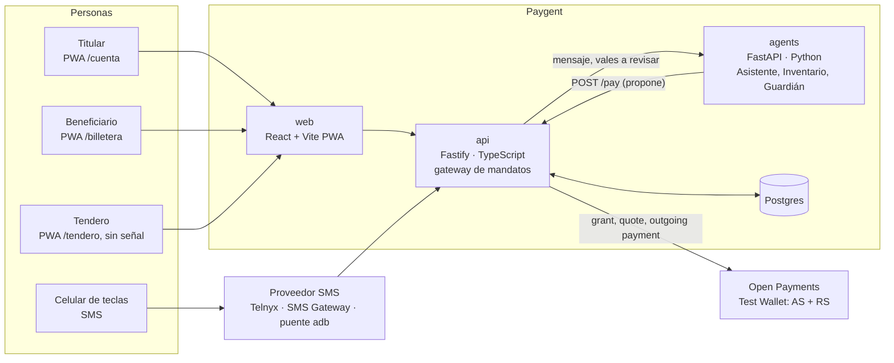
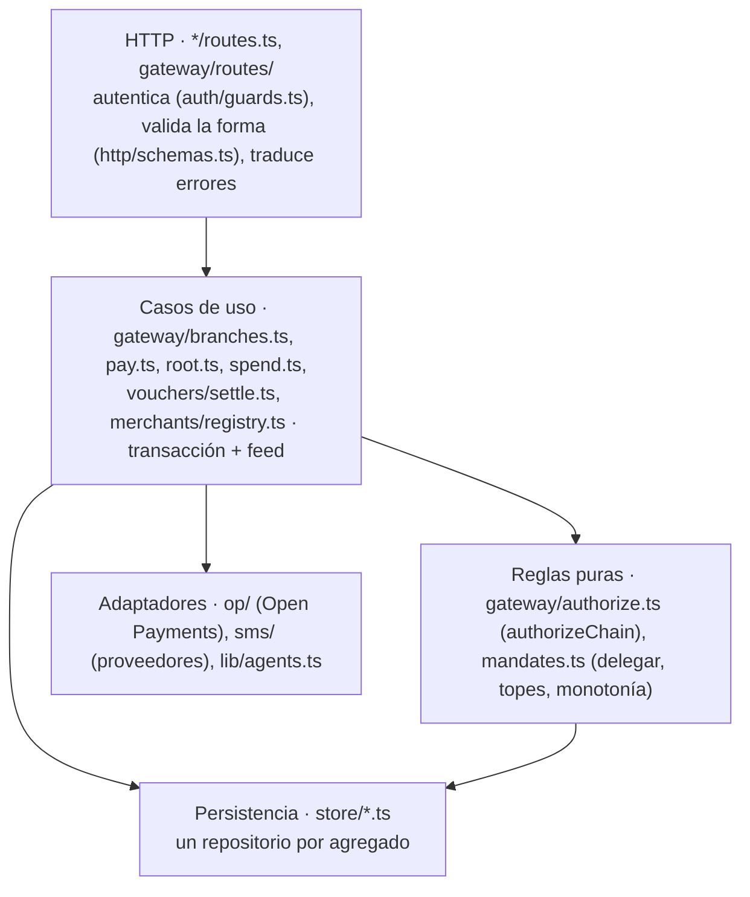
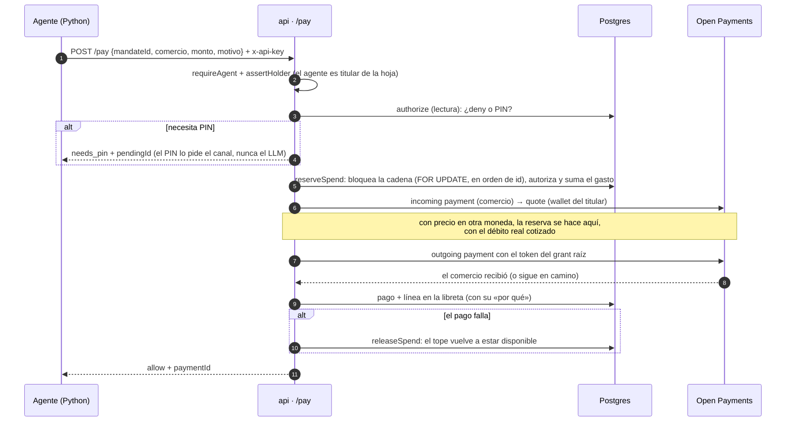

# Arquitectura

Paygent es un **monolito modular** (la api) con **un único punto de decisión** sobre el dinero (el gateway), un
**servicio de agentes aparte que no tiene llaves ni fondos**, y **adaptadores** hacia Open Payments y los proveedores
de SMS. Todo pago sale de la wallet del titular hacia el destinatario final bajo un solo grant: nadie en medio
custodia dinero.

Este documento explica cómo está organizado el código y por qué. El contrato de cada ruta está en
[`api/endpoints.md`](api/endpoints.md), y el esquema de datos, en [`api/modelo-de-datos.md`](api/modelo-de-datos.md).

## 1. Contenedores



| Contenedor | Responsabilidad | No hace |
|---|---|---|
| `src/api` | Autentica, decide (topes, categorías, PIN), mueve el dinero por Open Payments, guarda el árbol y la libreta | Interpretar lenguaje natural |
| `src/agents` | Entiende al usuario (LLM con respaldo de reglas), busca productos, explica las decisiones del Guardián | Tener llaves, fondos o la última palabra sobre un pago |
| `src/web` | PWA de los cuatro roles; verifica y firma vales sin conexión | Guardar secretos que no sean del propio celular |
| `src/shared` | Contrato común: tipos, montos y firma ed25519 de mandatos, certificados y vales | — |

`src/shared` es la razón de que la api esté en TypeScript: la verificación de un vale tiene que dar **exactamente**
el mismo resultado en el gateway y en el navegador del tendero sin conexión.

## 2. Capas de la api



| Carpeta | Capa | Qué hay |
|---|---|---|
| `gateway/routes/`, `*/routes.ts` | HTTP | Una ruta = autenticar → validar → llamar al caso de uso. Sin SQL |
| `auth/` | HTTP | Token de sesión (`session.ts`), guardias de permisos (`guards.ts`), login y registro |
| `http/schemas.ts` | HTTP | JSON Schema de los cuerpos (forma y tipos). Las reglas de negocio, con sus mensajes, viven en el dominio |
| `gateway/` | Dominio | Árbol de mandatos, autorización, pago, modos de consumo, canal SMS, certificados de celular |
| `vouchers/`, `merchants/`, `feed/` | Dominio | Liquidación de vales y Guardián · comercios · libreta (persistida + SSE) |
| `store/` | Persistencia | `sql.ts` (Postgres o PGlite, misma interfaz), migraciones y repositorios: `mandates`, `accounts`, `payments`, `grants`, `profiles`, `offline`, `merchants`, `feed`, `secrets`, `meta` |
| `op/` | Adaptador | Cliente autenticado, grants y `settle` (incoming → quote → outgoing). No conoce el árbol |
| `sms/`, `lib/agents.ts` | Adaptador | Webhooks y envío por proveedor; llamada al servicio de agentes con timeout |
| `puntored/` | Adaptador | Acreditación de Puntored al tendero sin wallet. Puntored no recibe pagos de Open Payments: hoy es `simulado` (el pago real llega a la wallet que lo representa); el real sería su API a llaves Bre-B + webhook firmado, sin tocar `gateway/acreditacion.ts` |
| `demo/` | Fixture | Semilla, raíz de la demo (`DEMO_ROOT_ID`) y su moneda. Nada del núcleo depende de ella |

**Reglas de dependencia**, comprobadas en [`src/api/test/arquitectura.test.ts`](../src/api/test/arquitectura.test.ts)
sobre los imports reales:

1. `store/` no importa nada del dominio, de Open Payments ni de HTTP.
2. `op/` no importa el dominio, la demo ni HTTP: es un adaptador intercambiable.
3. El dominio (`gateway/` sin `routes/`) no importa Fastify, `auth/`, `http/` ni la demo.
4. Ninguna ruta escribe SQL.

Cada repositorio recibe la conexión de forma opcional (`conn?: Sql`). Así un caso de uso compone varias escrituras en
una sola transacción (`sql().tx(tx => …)`), y nada dentro de ella abre otra conexión.

## 3. El camino del dinero



Los cinco invariantes de los agentes se aplican aquí, no en un prompt:

| Invariante | Dónde | Test |
|---|---|---|
| Un agente es una hoja y nunca gasta más que su sub-mandato | `authorizeChain` recorre la cadena hasta la raíz; `reserveSpend` | `gateway.test.ts`, `pay-concurrente.test.ts` |
| Los permisos solo se estrechan (monotonía) | `delegate`, `setLimits`, `restrict`, bloqueo del padre | `gateway.test.ts`, `varios-beneficiarios.test.ts` |
| Por encima del umbral, PIN (que nunca llega al LLM) | `authorizeChain` + `pending_purchases`; `assistant/router.py` lo intercepta | `gateway.test.ts`, `test_assistant.py` |
| Cada pago de un agente es un Outgoing Payment real | `executePayment` → `op/settle.ts` | `pnpm op:smoke`, `pnpm e2e` |
| Cada acción queda en la libreta con su porqué | `emit()` en cada caso de uso | `multi-payer.test.ts` |

## 4. Seguridad

- **Personas:** token sin estado `payload.HMAC-SHA256` (`auth/session.ts`), 7 días. La firma impide que el cliente
  elija su `userId`. El secreto es `SESSION_SECRET` o, si falta, se deriva de la llave del gateway guardada en la base.
- **Agentes:** una credencial de servicio (`x-api-key`) más el agente por el que actúa (`x-agent-id`, una fila).
  Un agente solo paga con mandatos de los que es titular, y nunca hace lo que decide una persona.
- **Autorización por rama:** *titular* (dueño de la raíz), *cadena* (la persona de la rama o su titular), *tendero*
  (dueño del comercio) y *titular o Guardián* para restringir. La matriz completa está en `api/endpoints.md`, y los
  ataques comprobados, en `src/api/test/auth.test.ts`.
- **Integridad:** cada mandato y cada certificado de celular van firmados con la llave ed25519 del gateway; cada vale
  lo firma la llave del celular. El tendero verifica sin conexión y el gateway vuelve a verificar al liquidar
  (contador único, acumulado y réplica, que congela el celular).
- **Guardián:** sus decisiones son reglas deterministas (`agents/guardian/rules.py`); el LLM solo redacta la
  explicación, y por API solo puede restringir.

## 5. Decisiones

| Decisión | Alternativa descartada | Por qué |
|---|---|---|
| Un grant raíz y sub-mandatos firmados por el gateway | Un grant de Open Payments por beneficiario | El titular aprueba **una** vez; Open Payments no delega grants. La delegación nativa es nuestra propuesta de extensión |
| El gateway decide y el agente propone | Dar al agente un token con límites | Un LLM manipulado no puede saltarse un tope que no controla. Los límites se prueban con tests, no con prompts |
| Reservar el gasto **antes** de pagar, bajo bloqueo | Sumar el gasto al confirmar | Con 250 ms–15 s de pago real, dos pagos a la vez veían el mismo disponible. Reproducido y probado en `pay-concurrente.test.ts` |
| Agentes en un servicio Python aparte | Agentes dentro de la api | Aislar el código probabilístico: sin llaves, con timeout y respaldo de reglas (`MOCK_LLM`, `LLM_TIMEOUT_S`) |
| Postgres, con PGlite en local y tests | Base en memoria o JSON | Las mismas consultas (CTE recursivas, `FOR UPDATE`) en dev, tests y prod sin instalar nada |
| Token firmado sin estado | Sesiones en la base | Sin tabla ni limpieza de sesiones; la revocación individual no hace falta para la demo |
| Una raíz revocada que se vuelve a firmar arranca sin beneficiarios | Conservar las ramas anuladas | Las ramas revocadas no se pueden reactivar (monotonía), y se quedaban visibles como «anuladas». Ver riesgos |

## 6. Compromisos y riesgos conocidos

- **Una sola instancia de la api.** El bus del feed (SSE), las cachés de tokens y wallets de Open Payments y los
  SMS ya atendidos viven en memoria. Para escalar: `LISTEN/NOTIFY` de Postgres para el feed y la deduplicación en
  una tabla.
- **`POST /sms/inbound` es público** porque lo usan el simulador `/celular` y el puente adb de la demo. Cualquiera
  puede escribir «como» un número, pero cada compra del modo SMS pide el PIN de la persona, y 5 fallos seguidos en
  ese mandato (en cualquier compra) bloquean el PIN 15 minutos con aviso al titular: sin ese bloqueo se podían probar
  los 10.000 PIN pidiendo compras nuevas. Las consultas al Inventario que dispara (40 pesos) están acotadas por la hoja
  de datos (2.000 pesos por periodo). Los webhooks de Telnyx y SMS Gateway sí verifican la firma del proveedor. En
  producción, el simulador se apaga.
- **Las cuentas de demo tienen contraseña pública** (botón en el login, para el jurado). Quien entra como Juan puede
  hacer lo que haría Juan; su wallet es del Test Wallet (dinero de prueba).
- **El token del SSE va en la URL** (`?token=`), porque `EventSource` no admite cabeceras: puede quedar en los logs
  del proxy.
- **La validación del cuerpo va antes que la autenticación** en las rutas de personas: un cuerpo mal formado da 400
  antes que 401. `/pay` autentica primero.
- **Los errores del dominio llevan su código HTTP** (`gateway/errors.ts`). Es pragmático: cada regla trae su mensaje
  para la web sin una capa de traducción.
- **Un pago que llega tarde y falla** deja el tope consumido (lo seguro) y lo avisa en la libreta.
- **Vales sin conexión:** el riesgo está acotado por el tope sin señal; si el titular no tiene saldo al liquidar, el
  pago falla. Una reserva de fondos haría falta en Open Payments (propuesta).
- **Volver a firmar una raíz revocada borra el historial de sus ramas** (pagos en cascada; las líneas del feed quedan
  sin árbol). Es la solución barata; la completa sería archivar las ramas en vez de borrarlas.

## 7. Cómo comprobarlo

```bash
pnpm test                 # api (incluye capas, permisos y concurrencia) + web + agents
pnpm typecheck
pnpm e2e                  # guion de la demo contra los servicios corriendo (entra como Juan; resetea la demo)
pnpm op:smoke             # Open Payments real, MOCK_OP=0
```
