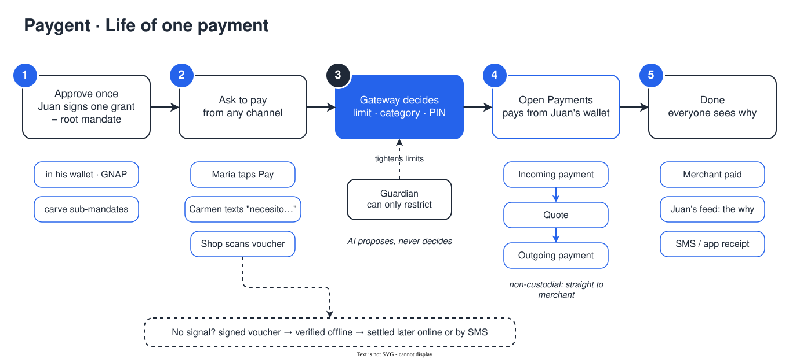

# Payment flow

Every payment — person, device or agent — follows the same four steps.

## 1. Grant (once)

The payer approves an interactive GNAP grant in their wallet.

| Step | Endpoint / SDK call |
|---|---|
| Request the root grant | `POST /mandates/root` → `client.grant.request` with `outgoing-payment`, `limits.debitAmount` and `limits.interval` |
| Payer consents | Redirect to the wallet (`interact.redirect`) |
| Continue the grant | `GET /callback/:rootId` → `client.grant.continue` with `interact_ref` |

If the payer signs a grant **smaller** than what is already delegated, branches shrink
proportionally, in cascade, and the feed records it.

## 2. Authorization (`/pay`)

`POST /pay` is the only spend entry point for agents. The rules engine
(`src/api/src/gateway/authorize.ts`) is pure and walks the chain leaf → root:

| Check | Deny reason |
|---|---|
| Leaf can spend | `cannot_spend` |
| Positive amount | `over_limit` |
| No mandate in the chain is revoked, frozen or expired | `revoked` · `frozen` · `expired` |
| Category allowed at every level | `category` |
| `spentInPeriod + amount ≤ maxDebit` at every level | `over_limit` |
| Above the leaf's `pinThreshold` (0 = always) | returns `needs_pin` |

On `needs_pin`, the gateway stores a pending purchase (10 min TTL). The caller retries with
`pendingId` + `pin`. Three wrong PINs drop the pending purchase.

The delivery address always comes from the root's registered address, never from the agent.

## 3. Settlement (Open Payments)

`src/api/src/op/settle.ts`, for each allowed payment:

1. **Incoming Payment** on the merchant's wallet (non-interactive grant), with `incomingAmount` and metadata.
2. **Quote** from the payer's wallet. The quoted `debitAmount` is re-authorized before paying, so PIN
   and limits use the real cost after FX.
3. **Outgoing Payment** with the root grant's token.
4. Wait for the merchant to receive it. `completed` only when the money arrived.

Merchants without a wallet are paid through Puntored's wallet, with the merchant and its Bre-B key
in the payment metadata. An expired token (`Inactive Token`) is rotated and retried once.

## 4. Feed

Every allow, deny, Guardian action and failed payment is emitted to the payer's feed
(`GET /feed`, live via SSE `GET /feed/stream?root=`) with its reason.

## Revocation

`POST /mandates/:id/revoke` revokes a branch and its descendants. On a root, it also cancels the
Open Payments grant. The rest of the tree keeps working.
